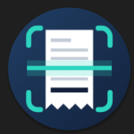
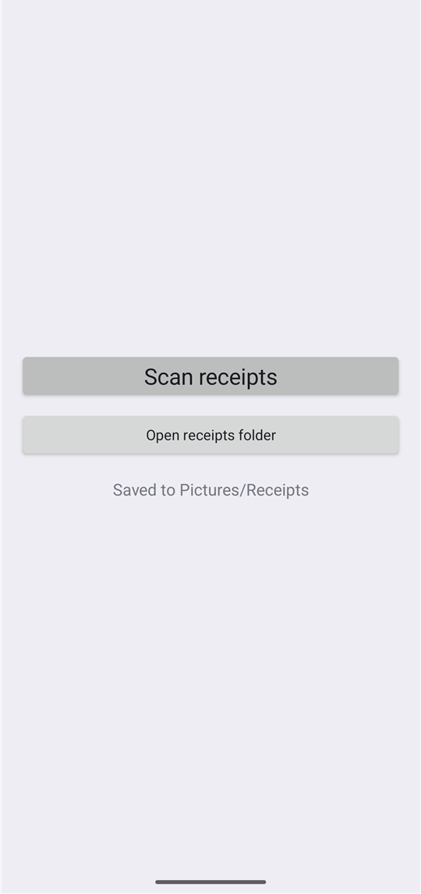
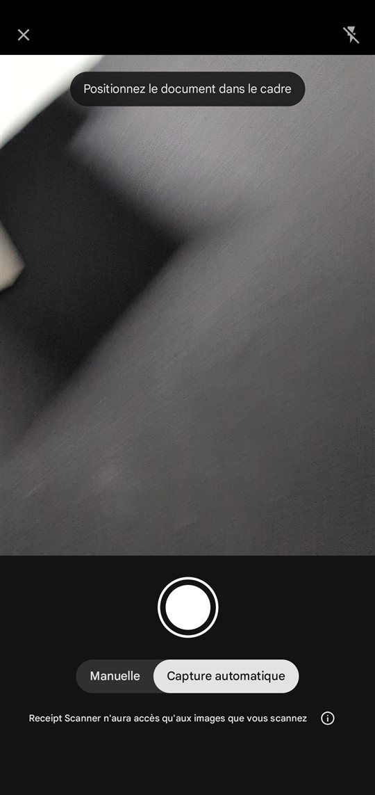

# Receipt Scanner

**[Download the APK](https://github.com/underscoreloG/receipt-scanner/releases/latest)** (latest release, Android 10+)

Minimal Android app for scanning a pile of paper receipts quickly. One tap opens Google's ML Kit Document Scanner (automatic edge detection, crop, flatten). Each scanned page is saved as a JPEG in `Pictures/Receipts` when you finish, and you land back on the main screen. The scanner accepts up to 100 pages per session, so you can add several receipts before finishing.

- Java, no UI libraries, minSdk 29, targetSdk 36
- Needs Google Play services on the phone (the scanner module comes from there)
- No accounts, no cloud, no network use by the app itself

## Screenshots

  
  &nbsp;
  

Left: main screen. Right: the scanner with auto-capture, which takes the picture when it sees a paper. The main screen shot was taken on an emulator, the scanner shot on a Pixel 9 Pro XL.

## How to use

1. Tap **Scan receipts**.
2. Lay a flattened receipt on a dark, plain surface and let auto-capture take it. To add another receipt to the same batch, use the scanner's add-page option, then repeat.
3. Press the scanner's final button (its label comes from Google's scanner and can read Next or Done) to save everything and return to the main screen, which shows how many receipts were saved since the app was opened.
4. **Open receipts folder** opens `Pictures/Receipts` in the Files app.

## Back up the receipts with Google Photos

Google Photos can back up just this folder, without turning on backup for the whole camera roll. These steps follow [Google's help page on choosing device folders to back up](https://support.google.com/photos/answer/6193313); menu names can differ slightly by app version and language.

1. Scan at least one receipt first, so the `Receipts` folder exists on the phone.
2. Open the **Google Photos** app.
3. At the bottom, tap **Library** (called **Collections** in newer versions), then **Photos on device** (or **View all**).
4. Tap the **Receipts** folder.
5. Turn on **Backup** (**Back up & sync**) for that folder.

From then on, every new scan in `Pictures/Receipts` is uploaded to your Google Photos library.

Receipts can carry store details and the last digits of your card. Once they are backed up they live in your Google account like any other photo, so check that this is what you want.

## Build

1. Create `local.properties` with `sdk.dir=<path to Android SDK>`.
2. Run `gradle assembleDebug` (Gradle 8.14+, JDK 17+). No Gradle wrapper is checked in.
3. Install `app/build/outputs/apk/debug/app-debug.apk` with `adb install -r`.

`gradle.properties` sets `android.overridePathCheck=true` because the Windows profile path used for development contains an accented character. Remove it if your path is plain ASCII.
